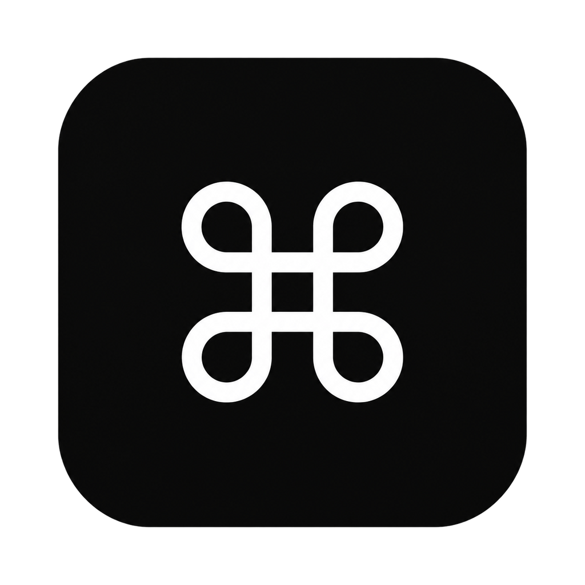
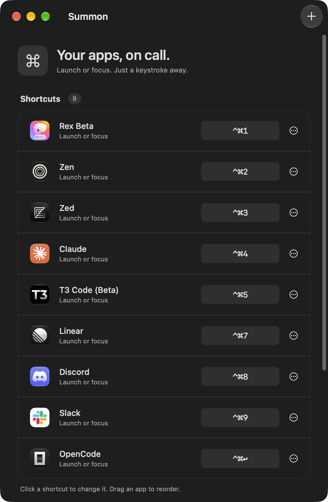
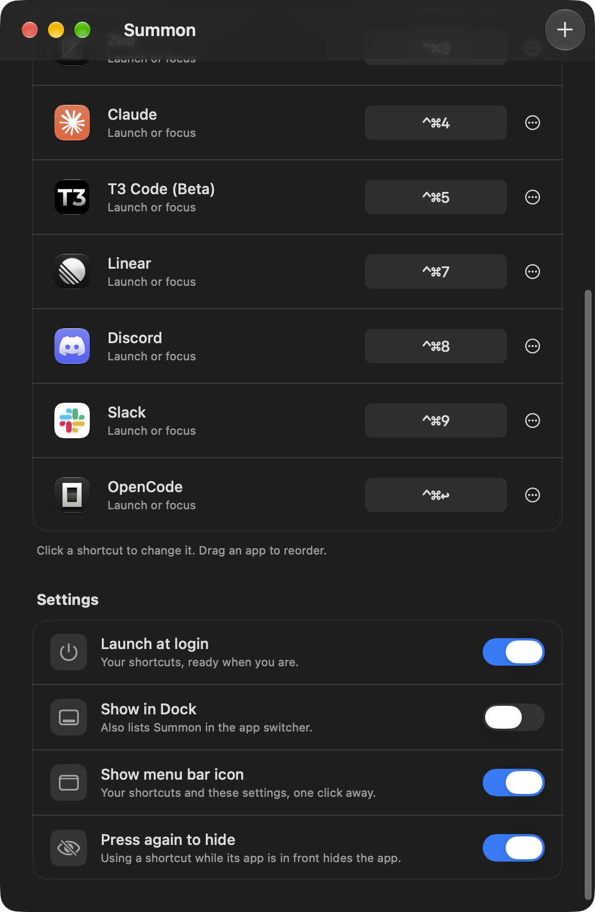

<p align="center">
  
</p>

<h1 align="center">Summon</h1>

<p align="center">
  <b>Your apps, on call.</b><br>
  A tiny macOS menu bar app that launches or focuses apps with global keyboard shortcuts.
</p>

<p align="center">
  
  
</p>

<p align="center">
  
  &nbsp;&nbsp;
  
</p>

Press ⌃⌘1 and Ghostty comes to the front. Press it again and it hides. Summon is a lightweight replacement for Raycast's app hotkeys.

## Features

- **Launch or focus** any app with a global shortcut. If it's already running, Summon brings it to the front.
- **Press again to hide**: pressing a shortcut while its app is in front hides the app.
- **Drag to reorder**: the order is saved and used in the menu bar menu too.
- **No Accessibility permission needed.** Hotkeys use Carbon's `RegisterEventHotKey`.
- **Stays out of the way**: lives in the menu bar, with optional Dock icon and launch at login.

## Install

Requires macOS 26+.

```sh
brew install --cask timrekelj/tap/summon
```

### Build from source

Requires Xcode or the Swift 6.2+ toolchain.

```sh
./build.sh           # builds build/Summon.app
./build.sh install   # also copies it to /Applications and launches it
./release.sh 1.0.0   # signs, notarizes, publishes a GitHub release and updates the tap
```

## Usage

1. Open settings from the ⌘ icon in the menu bar.
2. Add an app with **+**.
3. Click its shortcut button and press a key combination. Esc cancels, Delete clears.
4. Drag an app's icon or name to reorder it.

### Settings

| Setting | What it does |
| --- | --- |
| **Launch at login** | Starts Summon when you log in. Works best from `/Applications`. |
| **Show in Dock** | Also lists Summon in the Dock and app switcher. |
| **Show menu bar icon** | Shows the ⌘ icon with your shortcuts and settings. |
| **Press again to hide** | Using a shortcut while its app is in front hides the app. |
| **Sound effects** | Soft clicks when you summon or hide an app, reorder, record a shortcut or flip a switch. |

### Good to know

- ⌘W and ⌘Q both just close the settings window; Summon keeps running. Quit from the menu bar icon or the Dock.
- If you've hidden the menu bar icon, open Summon again (Dock, Finder or Spotlight) to get back to settings.
- Coming from Raycast? Remove the same shortcuts there, otherwise both apps will respond.
